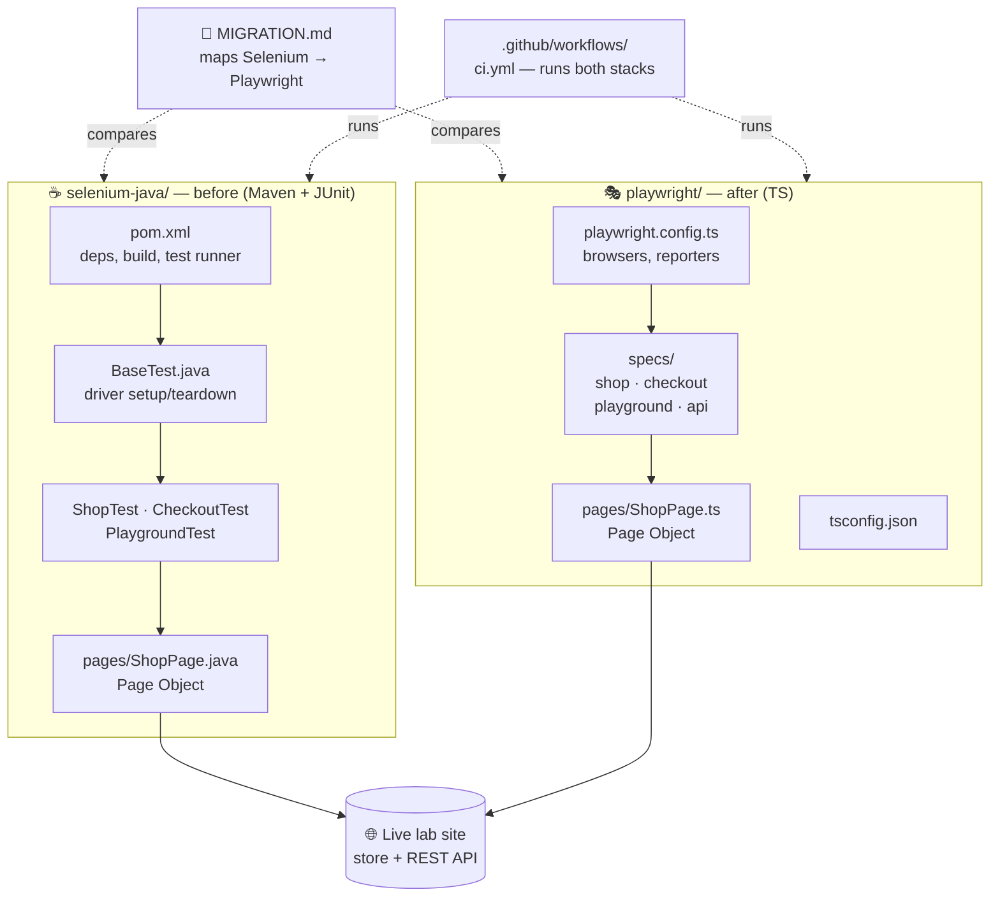

# Architecture

How this repo's folders fit together. It shows the **same tests written two ways, side by side**, so you can compare them line for line:

- **`selenium-java/`** — the "before": Selenium + Java (Maven, JUnit).
- **`playwright/`** — the "after": Playwright + TypeScript.

Both target the same live lab site and cover the same journeys (shop, checkout, playground, API). A written guide maps one to the other. CI runs both stacks.

## Every folder, top to bottom

| Folder / file | What it is | Why it's here |
|---|---|---|
| `selenium-java/` | The Selenium + Java project (Maven). | The "before" stack you're migrating *from*. |
| `selenium-java/pom.xml` | Maven build: dependencies, JUnit runner, Java version. | How the Java suite builds and runs (`mvn test`). |
| `selenium-java/src/test/java/lab/` | `BaseTest.java` (driver lifecycle), `ShopTest`, `CheckoutTest`, `PlaygroundTest`, and `pages/ShopPage.java`. | The Java tests and their Page Object — the thing being translated. |
| `playwright/` | The Playwright + TypeScript project. | The "after" stack you're migrating *to*. |
| `playwright/specs/` | `shop.spec.ts`, `checkout.spec.ts`, `playground.spec.ts`, `api.spec.ts`. | The same journeys, rewritten in Playwright. Run with `npm test`. |
| `playwright/pages/` | `ShopPage.ts` — the Page Object. | Direct counterpart to `ShopPage.java`, for a line-for-line compare. |
| `playwright/playwright.config.ts` | Browsers, base URL, reporters. | How the TS suite runs. |
| `playwright/tsconfig.json` | TypeScript strict-mode settings. | `npm run typecheck` checks every file against it. |
| `MIGRATION.md` | Written guide mapping each Selenium pattern to its Playwright equivalent. | The point of the repo — read it beside the two `ShopPage` files. |
| `.github/workflows/` | `ci.yml`. | Builds/runs both stacks in CI. |

> **Two stacks, two toolchains.** The Java side uses Maven (`mvn test`); the TypeScript side uses npm (`npm install`, `npm test`). The folders you *edit* are `selenium-java/src/` and `playwright/specs/` + `playwright/pages/`.
